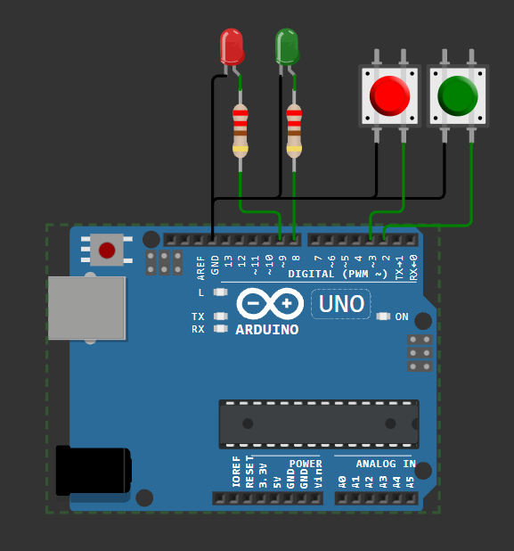

# Código de Arduino - Control de E/S

Este directorio contiene el firmware programado para la placa Arduino.

## Características Principales
- **Lectura de Entradas:** Configuración de pines digitales con resistencias `INPUT_PULLUP` para la conexión de pulsadores/llaves.
- **Accionamiento de Salidas:** Control de dos salidas digitales (`L1` y `L2`) conectadas a LEDs.
- **Lógica de Flancos:** Detección de transiciones para alternar el estado de las salidas de manera independiente mediante los pulsadores físicos.
- **Comunicación Serial:** Envío periódico de estados locales y recepción de comandos desde Processing a una velocidad de `9600 baudios`.

## Conexión del Circuito

- **Pin 2:** Pulsador / Entrada 1 (`E1`) hacia GND.
- **Pin 3:** Pulsador / Entrada 2 (`E2`) hacia GND.
- **Pin 8:** Salida LED 1 (`L1`) con resistencia de protección de $220\,\Omega$.
- **Pin 9:** Salida LED 2 (`L2`) con resistencia de protección de $220\,\Omega$.

## Instrucciones de Uso
1. Abre el archivo `.ino` con el IDE de Arduino.
2. Selecciona tu placa y el puerto COM correspondiente.
3. Carga el programa en la placa física o simúlalo en tu entorno de preferencia.
